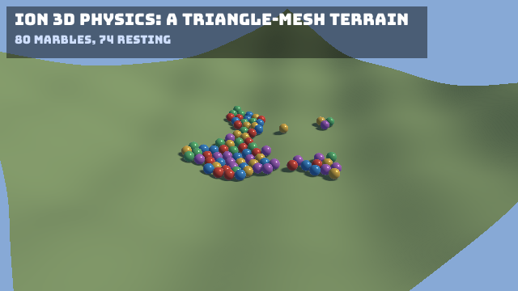

**Source:** [`Ion.Examples/Ion.Examples.Marbles`](https://github.com/jimbuck/Ion/tree/main/Ion.Examples/Ion.Examples.Marbles).

Eighty marbles drop onto a bowl of rippled terrain, roll downhill and come to rest in its dips. The terrain is a single
mesh. The 3D renderer draws it, and the 3D physics module collides against the same triangles as a static mesh collider.



## What it shows

- The 3D physics module on the ECS (`AddPhysics3D`, `UsePhysics3D`): dynamic sphere bodies and a static body.
- A triangle-mesh collider made from render data: `IPhysicsWorld3D.CreateMesh(mesh.Positions, mesh.Indices)` and
  `Collider3D.TriangleMesh(id)`.
- Collision layers: the marbles and the terrain are on different layers, so a ray cast can ask for the terrain alone.
- Game code that tends the bodies from a `FixedUpdate` step: counting the resting marbles, and putting back any that
  leaves the terrain.
- Positional audio: a marble that lands clicks from where it touched (`ISpatialAudio.Play` at the contact point,
  louder the faster it lands), heard from the camera, which carries an `AudioListener` (`UseEcsAudio`).

## Run it

```bash
dotnet run --project Ion.Examples/Ion.Examples.Marbles
npm run example:marbles                                   # the same, in Release
dotnet run --project Ion.Examples/Ion.Examples.Marbles -- --Marbles:Count=400
dotnet run --project Ion.Examples/Ion.Examples.Marbles -- --Ion:Physics3D:DebugDraw=true
```

| Flag | Effect |
|---|---|
| `--Marbles:Count=<n>` | The number of marbles (default 80, at most 2,000). |
| `--Marbles:Seed=<n>` | Where they are dropped (default 1). |
| `--Ion:Physics3D:DebugDraw=true` | Draw the colliders, the terrain's mesh included. |

## The terrain

The terrain is the renderer's plane with every vertex lifted by a height function, so its front faces point up like the
plane's:

```csharp title="Program.cs"
public static float Height(float x, float z) => 0.012f * (x * x + z * z) + 0.7f * MathF.Sin(x * 0.45f) * MathF.Cos(z * 0.4f);

public static MeshData CreateMesh()
{
	var mesh = MeshPrimitives.Plane(Size, Subdivisions);   // 40 units, 64 x 64 quads: 8,192 triangles
	var positions = mesh.Positions;
	for (var i = 0; i < positions.Length; i++) positions[i].Y = Height(positions[i].X, positions[i].Z);
	mesh.ComputeNormals();
	mesh.ComputeTangents();
	return mesh;
}
```

One mesh, used twice:

```csharp title="Program.cs"
var terrain = Terrain.CreateMesh();
var ground = renderer.CreateMesh(terrain);                                 // drawn
var collider = physics.CreateMesh(terrain.Positions, terrain.Indices);    // collided against
world.Create(Transform.Identity, new MeshRenderer(ground, groundMaterial),
	Collider3D.TriangleMesh(collider) with { Layer = Terrain.Layer, Friction = 0.8f });
```

Without a rigid body the terrain entity is a static body. Mesh colliders are one-sided: they collide on the side their
triangles face, which here is up. See [Triangle meshes](/Ion/physics/physics-3d/#triangle-meshes).

For a level made in a modelling tool, load the same glTF file twice, as an `IModel` to draw and as a `ModelGeometry`
for its triangles, and pass `geometry.Positions` and `geometry.Indices` to `CreateMesh`.

## The marbles

Each marble is a mesh renderer, a sphere collider on its own layer and a dynamic body:

```csharp title="Program.cs"
world.Create(new Transform(DropPosition(random, i)), new MeshRenderer(sphere, materials[i % materials.Length]),
	Collider3D.Sphere(Radius) with { Layer = MarbleLayer, Friction = 0.5f }, RigidBody3D.Dynamic(mass: 1f) with { AngularDamping = 0.4f }, new Marble(i));
```

They are dropped at staggered heights over the middle of the bowl. A fixed step counts the resting ones for the HUD and
puts back any marble that falls below the terrain. With a closed collider none does, which the tests check.

## The clicks

The camera entity is the listener (`new AudioListener()` on it, and `UseEcsAudio()` in `Program.cs`). After the physics
step, a fixed step reads the contacts that began and plays a click at each contact point, up to four per step:

```csharp title="Program.cs"
var speed = world.Get<RigidBody3D>(marble).LinearVelocity.Length();
if (speed < 1f) continue;
spatial.Play(_click, contact.Point, volume: Math.Clamp(speed / 10f, 0.1f, 1f), pitchShift: pitch, attenuation: ClickFalloff);
```

A marble landing on the left of the screen is heard on the left, and the far side of the bowl is quieter than the near
side. As the camera orbits, the same spot moves from ear to ear.

## Tests

`Ion.Examples.Marbles.Tests` runs the sample's own `Program.cs`:

- Headless, without a GPU, for 600 frames: no marble was put back, and a ray cast straight down from each marble's
  center, on the terrain's layer only, hits the terrain at least nearly a radius below. A marble under the surface would
  see the back of the triangles, which do not collide. More than half of the marbles rest on the surface the height
  function describes.
- The terrain mesh matches the height function, and every triangle faces up.
- Rendered headless on Vulkan and OpenGL ES after 240 frames: the marbles are visible, with pixels of their palette's
  colors.
- The clicks: the listener is at the camera, and the clicks played are panned to both sides.

## See also

- [3D physics](/Ion/physics/physics-3d/) and [Compound bodies](/Ion/physics/overview/#compound-bodies)
- [Models and glTF](/Ion/rendering/3d/models-gltf/#a-models-triangles-modelgeometry)
- [Cubes](/Ion/examples/cubes/): the 3D renderer on the ECS without physics
