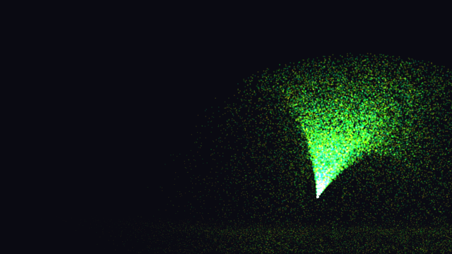

**Source:** [`Ion.Examples/Ion.Examples.Particles`](https://github.com/jimbuck/Ion/tree/main/Ion.Examples/Ion.Examples.Particles).

A fountain of particles sprays from an emitter that sweeps left and right, falls under gravity and bounces on the floor.
Every frame a compute shader steps all 65,536 particles in a storage buffer, and a render pass draws that same buffer as
instanced quads. The CPU uploads the starting particles once and then only writes two small uniform blocks per frame.



It needs compute shaders: Vulkan, or OpenGL ES 3.1 and later. On an OpenGL ES 3.0 device it logs a warning and shows
the clear color. Headless without rendering (no GPU), it runs and draws nothing.

## What it shows

- A compute pipeline and a compute pass: one bind group with a uniform buffer and a `ReadWriteStorageBuffer`, and
  `DispatchFor(count, 64)`.
- One buffer used two ways, created with `BufferUsage.Storage | BufferUsage.Vertex`: written by the compute pass and
  read by the draw as an instance-rate vertex buffer. Drawing from a vertex buffer instead of reading the storage buffer
  in the vertex shader keeps the sample portable, because OpenGL ES 3.1 does not guarantee storage buffers in the
  vertex stage.
- A compute pass and a render pass in one command buffer, with no barriers in the code: the draw sees the dispatch's
  writes (see [Compute shaders](/Ion/rendering/compute/#ordering)).
- Checking `device.Limits.ComputeShaders` and falling back when it is false.
- An RHI renderer inside a full `AddIon()` game, through `IGraphicsFrame`.

## Run it

```bash
dotnet run --project Ion.Examples/Ion.Examples.Particles
npm run example:particles              # the same, in Release
dotnet run --project Ion.Examples/Ion.Examples.Particles -- --Particles:Count=1000000
dotnet run --project Ion.Examples/Ion.Examples.Particles -- --headless --headless-render --Ion:Run:Frames=240 --Ion:Run:Screenshot=particles.png
```

| Flag | Effect |
|---|---|
| `--Particles:Count=<n>` | The number of particles (default 65,536, at most 4,194,304). |
| `--Particles:Size=<s>` | The half size of a particle at full life, in world units (default 0.012; the floor-to-ceiling height is 2). |
| `--Particles:Seed=<n>` | The seed of the starting particles (default 1). |
| `--Ion:Graphics:PreferredBackend=OpenGLES` | Run on OpenGL ES. |
| `--Ion:Graphics:Gles:MaxFeatureLevel=Es30` | Force the OpenGL ES 3.0 paths, which have no compute (the fallback). |

## How it works

A particle is two `vec4`s, 32 bytes: position and velocity, then color and life (1 at spawn, 0 at death).

```csharp title="GpuParticles.cs"
[StructLayout(LayoutKind.Sequential)]
public readonly record struct Particle(Vector4 State, Vector4 Color);
```

`particles.comp` runs one invocation per particle in workgroups of 64. It ages the particle and applies gravity, and
bounces it off the floor at y = -1. A particle whose life ran out respawns at the emitter, in a cone around straight
up, with a hash of its index and the frame number as the random seed:

```glsl title="Shaders/particles.comp"
void main()
{
	uint i = gl_GlobalInvocationID.x;
	if (i >= uSim.count) return;

	Particle p = uParticles.particles[i];
	float life = p.color.a - uSim.dt / uSim.lifetime;
	if (life <= 0.0)
	{
		uint seed = i * 9781u + uSim.frame * 6271u + 1u;
		float angle = 1.5707963 + (random01(seed) - 0.5) * 0.8;
		float speed = uSim.speed * (0.7 + 0.5 * random01(seed));
		p.state = vec4(uSim.emitter, vec2(cos(angle), sin(angle)) * speed);
		p.color = vec4(hue(uSim.time * 0.05 + random01(seed) * 0.3), 1.0 + life);
	}
	else
	{
		// gravity, then a bounce on the floor
	}

	uParticles.particles[i] = p;
}
```

Each frame, `StepAndDraw` records both passes into one encoder:

```csharp title="GpuParticles.cs"
_device.Queue.WriteBuffer(_simulationUniforms, 0, simulation);
_device.Queue.WriteBuffer(_viewUniforms, 0, view);

var encoder = _device.CreateCommandEncoder("Particles");
var compute = encoder.BeginComputePass("Particle simulation");
compute.SetPipeline(_simulate);
compute.SetBindGroup(0, _simulationGroup);
compute.DispatchFor(Count, WorkgroupSize);
compute.End();

var pass = encoder.BeginRenderPass(new RenderPassDescriptor([frame.ColorAttachment()], label: "Particles"));
pass.SetPipeline(_draw);
pass.SetBindGroup(0, _drawGroup);
pass.SetVertexBuffer(0, _particles);   // the buffer the compute pass just wrote
pass.Draw(4, Count);                   // a 4-vertex triangle strip per particle
pass.End();
_device.Queue.Submit(encoder.Finish());
```

The draw pipeline reads the particle buffer with `VertexStepMode.Instance` (two `Float32x4` attributes) and builds each
quad's corners from `gl_VertexIndex`. The fragment shader draws a soft round dot faded by life, with
`BlendState.Additive`, so dense regions glow.

The starting particles (`ParticleSystem.Seed`) are already in flight, with lives spread over (0, 1], so particles
respawn at a steady rate from the first frame instead of all at once.

## Tests

`Ion.Examples.Particles.Tests` runs the sample's own `Program.cs` headless with rendering on, under validation:

- On Vulkan, OpenGL ES and the OpenGL ES 3.1 paths, it reads the particle buffer back (`GpuParticles.Read`) before and
  after 30 frames. Every particle must be alive, finite and above the floor, almost all must have moved, and some must
  have respawned. The screenshot must be lit by the particles.
- At the OpenGL ES 3.0 level, the sample runs without errors and draws nothing.
- Without a GPU (null graphics), the sample runs.

## See also

- [Compute shaders](/Ion/rendering/compute/)
- [Shaders](/Ion/rendering/shaders/)
- [Quad](/Ion/examples/quad/): the RHI's render side in one class
