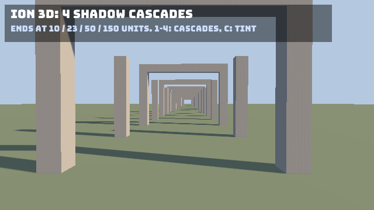

**Source:** [`Ion.Examples/Ion.Examples.Shadows`](https://github.com/jimbuck/Ion/tree/main/Ion.Examples/Ion.Examples.Shadows).

Thirty pairs of stone pillars, every other pair with a lintel, run from the camera's feet to 150 units away under a low
sun. The camera stands between the first pillars and sways slowly. Every pillar casts a shadow across the avenue: the
near ones are sharp, and the far ones are still there.



## What it shows

- Cascaded shadow maps with the renderer's defaults: four cascades over a `ShadowDistance` of 150 units
  (`appsettings.json`), with automatic splits and blending between cascades.
- Changing the cascades at run time through `Renderer3D.Options`: keys **1** to **4** set `ShadowCascades`, and **C**
  toggles `ShowShadowCascades`, which tints what each cascade covers.
- The last frame's cascades in `Renderer3D.ShadowCascadeSplits`, shown in the HUD.


## Run it

```bash
dotnet run --project Ion.Examples/Ion.Examples.Shadows
npm run example:shadows                                   # the same, in Release
dotnet run --project Ion.Examples/Ion.Examples.Shadows -- --Ion:Rendering3D:ShadowCascades=1
dotnet run --project Ion.Examples/Ion.Examples.Shadows -- --Ion:Rendering3D:ShowShadowCascades=true
```

With one cascade, the single 2048-texel map covers all 150 units: the shadows near the camera turn soft and blocky.
With four, the first cascade covers about the first 10 units at 1024 texels.

## The scene

The pillars are scaled cubes placed in a loop. The sun shines low across the avenue:

```csharp title="Program.cs"
world.Create(new Transform(Vector3.Zero, Transform.LookRotation(new Vector3(-0.8f, -0.45f, -0.25f), Vector3.UnitY)),
	new DirectionalLight(new Color(0xFF, 0xEC, 0xD0), intensity: 3f), new EntityName("sun"));
```

The keys change the renderer's options directly. They are read every frame, so the next frame uses them:

```csharp title="Program.cs"
for (var n = 1; n <= 4; n++)
{
	if (input.Pressed(Key.Number1 + (n - 1))) renderer.Options.ShadowCascades = n;
}

if (input.Pressed(Key.C)) renderer.Options.ShowShadowCascades = !renderer.Options.ShowShadowCascades;
```

## Tests

`Ion.Examples.Shadows.Tests` runs the sample's own `Program.cs`:

- Headless, without a GPU: four cascades whose last ends at the shadow distance, more casters than pillar pairs, and a
  cascade count changed at run time takes effect on the next frame.
- Rendered headless on Vulkan and OpenGL ES: shadowed grass near the camera and far down the avenue. The far band has
  at least three times the shadow of the same frame rendered with a 20-unit shadow distance.

## See also

- [Lighting and shadows](/Ion/rendering/3d/lighting-and-shadows/#cascades)
- [Configuration](/Ion/reference/configuration/)
