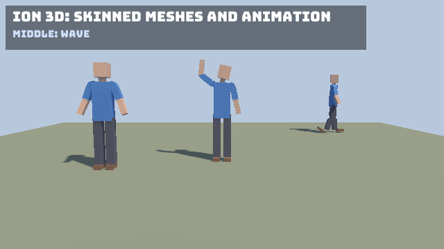

A skinned mesh is moved by a skeleton. Each vertex follows up to four joints, blended by its weights. Ion imports
skeletons and animation clips from glTF, poses the skeleton on the CPU and skins the mesh on the GPU, shadows included.
The [Puppet sample](/Ion/examples/puppet/) shows all of it.



## The pieces

| Type | What it is |
|---|---|
| `Skeleton` | The joints: each joint's name, parent, rest transform and inverse bind matrix. |
| `AnimationClip` | Named channels of joint translations, rotations and scales over time, with a `Duration`. |
| `AnimationChannel` | The keys of one property of one joint: `Times`, `Values`, and `Step`, `Linear` or `CubicSpline` interpolation. |
| `AnimationPlayer` | Plays clips on a skeleton: time, looping, speed and cross-fades. Every `Update` works out the pose, the joint matrices and the skinning palette. |
| `MeshData.Joints` / `MeshData.Weights` | Per vertex, four joint indices (`JointIndices`) and their weights. A mesh with both is skinned. |
| `IMeshBatch.Submit(renderer, world, joints)` | Draws a skinned mesh posed by a palette of one matrix per joint. |

## From glTF

`Load<IModel>` reads a file's skins and animations along with its meshes:

- Every skin becomes a `Skeleton` in `model.Skins`, with its joints in the skin's order (the order the vertices'
  `JOINTS_0` index them).
- Every animation becomes an `AnimationClip` in `model.Animations`. The clip belongs to the skin whose joints it
  animates, and `model.SkinOf(clip)` tells you which. `model.FindAnimation("Walk")` finds a clip by name.
- A primitive with `JOINTS_0` and `WEIGHTS_0` on a node with a skin has `ModelPrimitive.Skin` set to that skin's index.
  Joints may be unsigned bytes or shorts, and weights floats or normalized integers. The loader renormalizes weights to
  sum to 1.

The import has these limits:

- Translation, rotation and scale channels of joints are imported. Morph targets and their `weights` channels are not.
- Channels that animate nodes outside the clip's skin are dropped, so rigid node animation is not played. An animation
  of no joint at all is skipped.
- The root joints hang under the model matrix of the first root joint's parent node.

## Playing clips

`AnimationPlayer` holds one skeleton's playback state:

```csharp
var model = assets.Load<IModel>("puppet.gltf");
var player = new AnimationPlayer(model.Skins[0]);
player.Play(model.FindAnimation("Idle")!);

// Later, to change clips: fade the new clip in over 0.4 seconds while both play.
player.CrossFade(model.FindAnimation("Walk")!, 0.4f);
```

| Member | Meaning |
|---|---|
| `Play(clip, loop = true, speed = 1)` | Plays a clip from its start (or its end, with a negative speed), at once. |
| `CrossFade(clip, duration, loop = true, speed = 1)` | Fades from the playing clip to `clip`. Both clips advance meanwhile, and then `clip` becomes `Clip`. |
| `Stop()` | Back to the rest pose. |
| `Update(dt)` | Advances the clips and evaluates. |
| `Evaluate()` | Evaluates without advancing, for example after setting `Time` yourself. |
| `Clip`, `Time`, `Speed`, `Loop` | The playing clip and its state. `Time` is settable. |
| `Next`, `NextTime`, `FadeWeight` | The clip being faded in, its time, and how far the fade has gone (0 to 1). |
| `IsFinished` | A non-looping clip reached its end (it holds its last pose). |
| `Pose` | One local `Transform` per joint. |
| `JointMatrices` | Each joint's matrix in model space. Multiply by the model's world matrix to attach something to a hand. |
| `SkinningMatrices` | The palette to draw with: each joint's inverse bind matrix times its model matrix. |

The player allocates nothing after it is created. `Play` refuses a clip that animates joints the skeleton does not have.

For blends of your own, sample clips into poses and combine them:

```csharp
var walk = skeleton.CreateRestPose();
var run = skeleton.CreateRestPose();
walkClip.Sample(time * walkClip.Duration, walk);
runClip.Sample(time * runClip.Duration, run);
AnimationPose.Blend(walk, run, speedBlend, walk);

skeleton.ComputeModelMatrices(walk, model);
skeleton.ComputeSkinningMatrices(model, palette);
renderer.Submit(meshRenderer, world, palette);
```

`AnimationClip.Sample` writes only the joints and properties the clip animates, so start from the rest pose
(`CopyRestPose`). Rotations are interpolated spherically and come out normalized.

## On the ECS

`SpawnModel` sets a skinned model up for you:

- The root entity gets an `Animator` (its `AnimationPlayer`) for the model's first skin. Any other skins get theirs on
  child entities of the root.
- Each skinned primitive's entity gets a `SkinnedMesh` that points at its skin's animator entity.

```csharp
var root = world.SpawnModel(model, new Transform(new Vector3(2, 0, 0)));
world.Get<Animator>(root).Player.Play(model.FindAnimation("Walk")!);
```

`SkeletalAnimationSystem` is part of `UseEcs()`. It advances every `Animator` in Update, at
`StageOrder.SpriteAnimation` (after your Update steps), so a clip you start in an Update step is already posed when the
frame is drawn. The 3D extraction submits each `SkinnedMesh` posed by its animator, at the **animator entity's** world
matrix: the palette places the vertices in model space. Move the root to move the character.

- `Hidden` (on the mesh's entity or an ancestor) and `RequireVisible` apply as for rigid meshes.
- While the animator entity is gone, or has no `Animator`, the mesh is drawn unskinned, in its bind pose, at its own
  entity's world matrix.
- The joints' node entities are spawned like any node, but the animation does not move them. Read
  `JointMatrices` to follow a joint.
- `Animator` and `SkinnedMesh` are not saved by the world serializers. Respawn the model after a load.

You can also put the components on entities of your own: an `Animator(new AnimationPlayer(skeleton))` on one entity
and `MeshRenderer` plus `SkinnedMesh(animatorEntity)` on each mesh entity.

## Without the ECS

Draw a model with its players, one per skin, or submit skinned meshes yourself:

```csharp
[Update]
public void Animate(GameTime dt) => _player.Update(dt.Delta);

[Render]
public void Render(GameTime dt)
{
    renderer.Draw(_model, world, _player);   // the skinned primitives posed, the rigid ones at their nodes
    // or: renderer.Submit(new MeshRenderer(mesh, material), world, _player.SkinningMatrices);
}
```

## How the renderer skins

- A skinned mesh keeps a second vertex stream of four joints and four weights (24 bytes per vertex, vertex buffer
  slot 2) next to its usual vertices.
- Every skinned submission's palette is copied into one RGBA32F joint texture for the frame. Each joint takes three
  texels, and the instance data records where the submission's joints start. Skinned draws of one mesh and material
  are still instanced together.
- The built-in `mesh_skinned.vert` and `depth_skinned.vert` read the palette (view group bindings 5 and 6), blend the
  four matrices, then apply the instance's world matrix. The shadow map and the depth prepass use the skinned depth
  stage, so shadows follow the pose.
- Culling uses a bound that holds every pose: the mesh's box under each joint's matrix.
- The palette must cover every joint the mesh's weighted vertices use. A shorter one throws an `ArgumentException`
  naming the joint. A rigid mesh, or an empty palette, is drawn rigid.
- Normals and tangents are moved by the blended matrix's 3x3 part. That is exact for rotations and uniform scales.
- A custom material shader's fragment stage draws skinned meshes unchanged. Its own vertex stage, if it has one,
  applies to rigid draws only.

## See also

- [Models and glTF](/Ion/rendering/3d/models-gltf/)
- [ECS rendering](/Ion/ecs/ecs-rendering/#spawning-models)
- [Puppet sample](/Ion/examples/puppet/)
