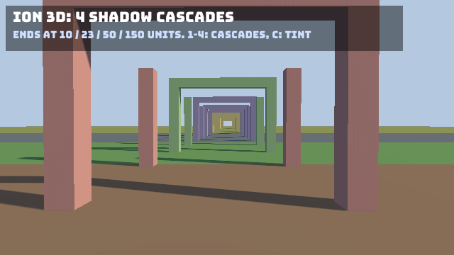

The 3D renderer lights PBR materials with:

- one **main directional light** (the sun), which can cast shadows,
- up to **8 local lights** per camera: point lights, spot lights and extra directional lights,
- **ambient light**: a flat color, plus image-based ambient from the **skybox** when there is one.

Unlit materials ignore all of it. Lights are submitted every frame, like meshes; the environment (ambient and skybox)
persists until you change it.

```csharp
[Render]
public void Draw(GameTime dt)
{
	renderer.SetCamera(new Camera(), Transform.LookAt(new Vector3(0, 4, 10), Vector3.Zero));

	// The sun, shining down and away from the camera.
	renderer.AddLight(new DirectionalLight(new Color(0xFF, 0xF4, 0xE0), intensity: 3f), new Vector3(-0.5f, -0.8f, -0.3f));

	// A warm point light near the ground.
	renderer.AddLight(new PointLight(new Color(0xFF, 0x90, 0x40), intensity: 2.5f, range: 5f), new Vector3(2.5f, 1.8f, 1.5f));

	renderer.Draw(_ground, _groundMaterial, Matrix4x4.Identity);
	renderer.Draw(_statue, _stone, Matrix4x4.CreateTranslation(0, 0, 0));
}
```

All light colors are sRGB `Color`s, converted to linear by the renderer and multiplied by the intensity.

## Directional lights

`DirectionalLight` models a distant light such as the sun: parallel rays, no position, no falloff.

| Field | Default (`new DirectionalLight()`) | Meaning |
|---|---|---|
| `Color` | `Color.White` | sRGB |
| `Intensity` | `1` | 1 gives the color at full strength on a surface facing the light |
| `CastShadows` | `true` | Whether this light casts shadows (only the main light can) |
| `ShadowBias` | `0` (the renderer's default, 1.5 texels) | Depth bias in shadow map texels |

The constructor takes the same values: `new DirectionalLight(color, intensity: 1f, castShadows: true)`.

Two ways to submit one:

```csharp
// By direction: the way the light travels.
renderer.AddLight(new DirectionalLight(Color.White, 2f), direction: new Vector3(-0.3f, -1f, -0.2f));

// By world matrix: the light shines along the matrix's -Z axis.
var sun = new Transform(Vector3.Zero, Transform.LookRotation(new Vector3(-0.65f, -0.6f, -0.3f), Vector3.UnitY));
renderer.AddLight(new DirectionalLight(Color.White, 3f), sun.ToMatrix());
```

The direction is normalized for you; a zero direction becomes straight down.

**The first directional light submitted in a frame with `CastShadows` set is the main light**, and it is shaded with the
shadow map. When no directional light casts shadows (or `Ion:Rendering3D:Shadows` is off), the first directional light
submitted is the main light instead. The other directional lights are added to the local light list (without shadows).

## Point lights

A `PointLight` radiates from a position and fades to zero at `Range`:

| Field | Default | Meaning |
|---|---|---|
| `Color` | `Color.White` | sRGB |
| `Intensity` | `1` | Strength |
| `Range` | `10` | The distance at which the light has faded out (0 or less: 10) |

```csharp
renderer.AddLight(new PointLight(new Color(0x50, 0x90, 0xFF), intensity: 2.5f, range: 5f), position: new Vector3(-2.5f, 1.2f, 1f));
```

The falloff is glTF's windowed inverse square: physically plausible near the light, reaching exactly zero at `Range`.

## Spot lights

A `SpotLight` is a cone along the -Z axis of its world matrix, full strength inside the inner angle, fading to zero at
the outer angle and at `Range`:

| Field | Default | Meaning |
|---|---|---|
| `Color`, `Intensity` | white, `1` | |
| `Range` | `10` | Fade-out distance |
| `InnerConeAngle` | 20 degrees (`PI / 9`) | Half angle in radians of full strength |
| `OuterConeAngle` | 30 degrees (`PI / 6`) | Half angle in radians beyond which there is no light |

```csharp
// A flashlight held by the camera.
var flashlight = new SpotLight { Color = Color.White, Intensity = 4f, Range = 15f, InnerConeAngle = 0.2f, OuterConeAngle = 0.35f };
renderer.AddLight(flashlight, _cameraTransform.ToMatrix());
```

## How many lights

Per camera, the renderer fills up to **8 local lights**: extra directional lights first (they light everything), then
point and spot lights in submission order whose range sphere intersects the camera's frustum. Lights beyond 8 are
dropped for that camera. For scenes with many small lights, submit only the ones near the action, most important
first.

`LastFrameStatistics.Lights` reports the lights used.

## Shadows

The main directional light renders a shadow map when:

- `Ion:Rendering3D:Shadows` is `true` (the default),
- at least one directional light of the frame has `CastShadows` set (the default; the first such light gets the map), and
- at least one camera renders.

| Option (`Ion:Rendering3D:...`) | Default | Effect |
|---|---|---|
| `Shadows` | `true` | Turn shadows off entirely |
| `ShadowMapSize` | `2048` | Resolution of the whole shadow map in texels. With more than one cascade each gets a quarter (1024 by default). Higher is sharper and costs more memory and fill rate |
| `ShadowDistance` | `40` | How far from the camera shadows reach, in world units |
| `ShadowCascades` | `4` | Cascades, 1 to 4 (see below) |
| `ShadowCascadeSplits` | none | Where each cascade ends, as fractions of `ShadowDistance` (for example `[0.1, 0.25, 0.5]`; the last cascade always ends at 1) |
| `ShadowSplitLambda` | `0.75` | Without explicit splits: 0 spaces the cascades evenly, 1 logarithmically, in between a mix |
| `ShadowCascadeBlend` | `0.1` | The fraction of each cascade over which it fades into the next (the last fades out to no shadow). 0 switches sharply |
| `ShowShadowCascades` | `false` | Tint what each cascade covers: red, green, blue, yellow from near to far |

### Cascades

One shadow map stretched over the whole shadow distance is either blurry (a long distance) or short. Cascaded shadow
maps split the camera's view, from its near plane to `ShadowDistance`, into up to four slices. Each slice gets its own
part of the shadow map: a 2x2 atlas of `ShadowMapSize / 2` tiles, or the whole map with one cascade. The nearest slice
is short, so its texels are small and the shadows at the camera's feet are sharp. The farthest is long, so shadows
still reach far.



How each cascade is fitted: the renderer takes its slice of the first frame camera's view frustum and covers the
slice's bounding sphere with an orthographic projection along the light. It snaps the projection to whole texels of the
tile, so shadow edges do not shimmer as the camera moves. The depth range is extended back to every caster whose
footprint overlaps the area, so objects outside the view still cast shadows into it. Each cascade has its own depth
bias and normal offset, scaled to its texel size.

A fragment takes the cascade its distance from that camera falls in. Over the last `ShadowCascadeBlend` of a cascade
it mixes in the next one, so the change of resolution does not show as a line. For that, each slice starts where the
previous one starts blending.

Sampling uses a comparison sampler with 3x3 taps, each a hardware 2x2 PCF, plus a normal offset and the depth bias, for
soft-edged shadows without acne. The taps stay inside the cascade's tile.

Every cascade draws the casters it covers, so four cascades cost up to four times the shadow draw calls of one. On a
low-end GPU, `ShadowCascades = 1` or 2 with a shorter `ShadowDistance` is cheaper. `ShowShadowCascades` (or
`renderer.Options` at run time, as the [Shadows sample](/Ion/examples/shadows/) does with its keys) helps place the
splits. The cascades of the last frame are in `Renderer3D.ShadowCascades`, and where they end in
`ShadowCascadeSplits`.

Per object, `MeshRenderer.CastShadows` and `ReceiveShadows` control participation:

```csharp
// A ground plane that receives shadows but never casts them, and a glowing orb that casts none.
renderer.Submit(new MeshRenderer(_ground, _grass) { CastShadows = false }, Matrix4x4.Identity);
renderer.Submit(new MeshRenderer(_orb, _glow) { CastShadows = false, ReceiveShadows = false }, orbWorld);
```

### Tuning shadows

| Symptom | Fix |
|---|---|
| Blurry, blocky shadows near the camera | Use more cascades, raise `ShadowSplitLambda` towards 1 (a shorter first cascade), lower `ShadowDistance` or raise `ShadowMapSize` |
| Shadows vanish in the distance | Raise `ShadowDistance` (more cascades keep the near ones sharp) |
| A visible line where the resolution changes | Raise `ShadowCascadeBlend` |
| Speckled self-shadowing ("acne") | Raise `DirectionalLight.ShadowBias` (texels, default 1.5) |
| Shadows detached from their casters ("peter-panning") | Lower `ShadowBias` |

The samples pick `ShadowDistance` to fit their scenes: 20 for the Model sample, 60 for the Cubes sample.

:::note[Shadow limits]
One shadowed directional light, with up to four cascades. Point and spot lights cast no shadows. Blended (`AlphaMode.Blend`)
objects cast no shadow, and masked objects cast the shadow of their full, unmasked shape.
:::

## Ambient light and the environment

`SceneEnvironment` holds the frame's ambient light and optional skybox. Unlike everything else, it persists: set it once
(for example in `[Init]`) and change it when the mood changes.

| Field | Default (`new SceneEnvironment()`) | Meaning |
|---|---|---|
| `AmbientColor` | dim grey (0.25) | sRGB |
| `AmbientIntensity` | `1` | Multiplier of `AmbientColor` |
| `Skybox` | none | A cube map `TextureHandle` (from `ICubemap.Handle`) |
| `SkyboxIntensity` | `1` | Multiplier of the skybox, as drawn and as ambient light |

```csharp
renderer.SetEnvironment(new SceneEnvironment { AmbientColor = new Color(0x9C, 0xB0, 0xD0), AmbientIntensity = 0.35f });
```

Ambient light is darkened by a material's occlusion map (`PbrMaterial.Occlusion`).

### Skybox and image-based ambient

Load a cube map from a folder of six images and put its handle in the environment. Set the camera's `Clear` to
`CameraClear.Skybox` to draw it behind the scene:

```csharp
[Init]
public void Init(GameTime dt)
{
	var skybox = assets.Load<ICubemap>("Skybox");   // Assets/Skybox/px.png, nx.png, py.png, ny.png, pz.png, nz.png
	renderer.SetEnvironment(new SceneEnvironment
	{
		AmbientColor = new Color(0x40, 0x48, 0x58),
		AmbientIntensity = 0.15f,
		Skybox = skybox.Handle,
		SkyboxIntensity = 1f,
	});
}

[Render]
public void Draw(GameTime dt)
{
	renderer.SetCamera(new Camera { Clear = CameraClear.Skybox }, Transform.LookAt(new Vector3(0, 2, 6.5f), new Vector3(0, 1.1f, 0)));
	// ...
}
```

The skybox also **lights the scene**: the PBR shader adds diffuse ambient from the cube map's smallest mip (a blurred
average of the sky) and specular reflections along the reflected view direction, from a sharper or blurrier mip
depending on roughness. Polished metals mirror the sky; rough surfaces pick up its overall tint. This is added to the
flat ambient color, so lower `AmbientIntensity` when you use a skybox, as the Model sample does.

The cube map faces are expected as `px nx py ny pz nz` (or `right left top bottom front back`) in `.png` or `.jpg`,
square and of one size. A camera looking down -Z (Ion's forward) sees the `pz` ("front") image unmirrored, `px` on its
right and `py` above. See [Models and glTF](/Ion/rendering/3d/models-gltf/#cube-maps) for the loader.

:::tip
To make the sun match a skybox's painted sun, point the directional light along the direction from the sun's position
in the sky toward the scene.
:::

## With the ECS

As components, lights take their position and direction from the entity's global transform:

| Component | Submitted as |
|---|---|
| `DirectionalLight` | Shining along the entity's -Z |
| `PointLight` | At the entity's position |
| `SpotLight` | At the entity's position, along its -Z |

The environment is a per-world singleton set with `world.SetEnvironment(...)` (read it back with `TryGetEnvironment`,
remove it with `RemoveEnvironment`). The extraction passes it to the renderer only when it changes.

```csharp
world.SetEnvironment(new SceneEnvironment { AmbientColor = new Color(0x9C, 0xB0, 0xD0), AmbientIntensity = 0.35f });

world.Create(new Transform(Vector3.Zero, Transform.LookRotation(new Vector3(-0.65f, -0.6f, -0.3f), Vector3.UnitY)),
	new DirectionalLight(new Color(0xFF, 0xF4, 0xE0), intensity: 3f), new EntityName("sun"));

world.Create(new Transform(new Vector3(2.5f, 1.8f, 1.5f)),
	new PointLight(new Color(0xFF, 0x90, 0x40), intensity: 2.5f, range: 5f), new EntityName("warm light"));
```

Because the shadow map goes to the first shadow-casting directional light submitted, in an ECS world with several
directional lights that cast shadows, which one gets it depends on query order. Set `CastShadows = false` on every
directional light except the one that should cast (fill and rim lights, for example), and it gets the shadow map
whatever the order.

## See also

- [Meshes and materials](/Ion/rendering/3d/meshes-and-materials/): PBR parameters
- [3D cameras](/Ion/rendering/3d/cameras/): clear modes and multiple cameras
- [Models and glTF](/Ion/rendering/3d/models-gltf/): loading cube maps
- [Model example](/Ion/examples/model/)
