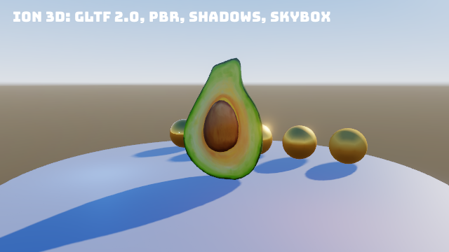

The 3D renderer can anti-alias the frame with multisampling, draw it in high dynamic range and map it to the display
with a tone curve, and add bloom around bright parts. All three are off by default and set from
`Ion:Rendering3D` (or `Rendering3DOptions` in code).

```json title="appsettings.json"
{
  "Ion": {
    "Rendering3D": {
      "Msaa": 4,
      "Hdr": true,
      "ToneMapping": "Aces",
      "Exposure": 1.0,
      "Bloom": true,
      "BloomThreshold": 1.0,
      "BloomIntensity": 0.6
    }
  }
}
```



The same from the command line, on any sample:

```bash
dotnet run --project Ion.Examples/Ion.Examples.Model -- --Ion:Rendering3D:Msaa=4 --Ion:Rendering3D:Hdr=true --Ion:Rendering3D:Bloom=true
```

## Settings

| Option (`Ion:Rendering3D:...`) | Default | Effect |
|---|---|---|
| `Msaa` | `1` | Samples per pixel: 1 (off), 2, 4 or 8 |
| `Hdr` | `false` | Draw the scene in RGBA16F and tone map it |
| `ToneMapping` | `Aces` | `Aces` (filmic: contrast in the mid tones, a soft shoulder), `Reinhard` (`c / (1 + c)`, gentle) or `None` (clip at 1) |
| `Exposure` | `1` | A multiplier of the HDR scene before the tone curve |
| `Bloom` | `false` | Bright parts bleed light around them |
| `BloomThreshold` | `1` | The brightness (linear) from which bloom starts. 1 is full white in LDR, so lower it without `Hdr` |
| `BloomSoftKnee` | `0.5` | How gradually bloom starts below the threshold, as a fraction of it (0: a hard cut) |
| `BloomIntensity` | `0.6` | How strongly the bloom is added |
| `BloomLevels` | `5` | Levels of the bloom chain, 1 to 8. More levels spread the light wider |

The renderer reads the options every frame, so changing `renderer.Options` at run time (a graphics menu, say) applies
from the next frame.

## How the frame is drawn

With any of the three on, the cameras that draw into the frame draw into a scene texture instead:

1. **Scene.** The frame's cameras draw their opaque, skybox and transparent passes into the scene texture: RGBA16F with
   `Hdr`, otherwise the frame's own format. With `Msaa` the texture and its depth are multisampled, and the depth
   prepass and the clear and skybox draws use the same sample count. Shaders write linear, unclamped color into an HDR
   scene (`ionOutput` in `ion_view.glsl` handles it), and clear colors are converted to linear.
2. **Resolve.** With `Msaa`, the multisampled scene is resolved into a single-sampled one (`ICommandEncoder.ResolveTexture`).
3. **Bloom.** A prefilter keeps what is brighter than the threshold (with the soft knee) at half the frame's size and
   clamps single bright pixels. Each further level halves the last with a dual-filter downsample. The chain is then
   added back up level by level with a 3x3 tent filter.
4. **Composite.** One pass into the frame adds the bloom. For an HDR scene it applies the exposure and the tone curve,
   and encodes sRGB when the frame's format does not. An LDR scene is copied as it is.
5. **2D overlay.** The sprite batch draws on top as before, unaffected by the tone curve.

These are render graph passes (`Resolve`, `BloomPrefilter`, `BloomDown.N`, `BloomUp.N`, `Composite`) at the start of
the post band (`RenderGraphPass.Orders.Post`), before your custom passes. The scene texture is registered as
`RenderGraphResources.SceneColor`, so a custom pass can read it.

Cameras with a render target (`Camera.Target`) are not post-processed: they draw into their RGBA8 target as before.
When no camera draws into the frame, the post passes do not run.

## Fallbacks

| Situation | What happens |
|---|---|
| `Msaa` above what the device supports (`DeviceLimits.MaxSampleCount`) | The highest power of two the device supports is used, and a warning is logged once |
| `Hdr` on a device that cannot render RGBA16F (`DeviceLimits.HdrRenderTargets` false: OpenGL ES without `EXT_color_buffer_half_float`) | The scene is drawn in the frame's format (low dynamic range) and the tone curve is skipped. Bloom still works, with a threshold below 1. A warning is logged once |
| No device (headless without rendering) | Nothing is drawn. The options are accepted and ignored |

OpenGL ES 3.0 guarantees 4 samples. Vulkan devices report their framebuffer sample counts, and RGBA16F rendering is
always available on Vulkan.

## Cost

- **MSAA** multiplies the color and depth memory of the frame's cameras by the sample count. It also costs fill rate on
  edges and a resolve per frame. 4 samples is the usual balance. On tile-based mobile GPUs MSAA is cheap, but the
  resolve still reads the whole scene.
- **HDR** doubles the scene texture's size (8 bytes per pixel).
- **Bloom** runs about two passes per level, over textures of a quarter of the frame's pixels and less. Five levels
  cost a little more than one full-screen pass.

## See also

- [Lighting and shadows](/Ion/rendering/3d/lighting-and-shadows/): emissive materials are what usually blooms (`PbrMaterial.EmissiveIntensity` above 1)
- [Graphics backends](/Ion/rendering/graphics-backends/#portability-rules): device limits
- [Configuration](/Ion/reference/configuration/)
